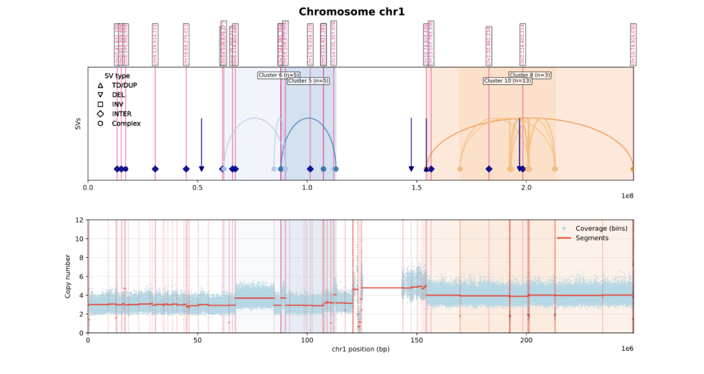

# Toolshed

This is a collection of small tools and experiments. The first one here is a
notebook for looking at structural variants alongside copy-number data.



## The SV plot

The notebook draws two aligned tracks for a chromosome:

- coverage and copy-number segments on top;
- structural-variant breakpoints and arcs underneath;
- shaded regions for SV clusters when they are available.

Intra-chromosomal events are drawn as arcs. Events that connect to another
chromosome are shown with breakpoint markers and guide lines. The included PDF
is a full-size example of the output.

## Running it

The main tool is a Python script and requires Python 3.9 or newer. From the
repository root:

```bash
python -m pip install -r requirements.txt
```

Run it by passing the coverage, segmentation, and BEDPE files:

```bash
python examples/complex-svs/complex_sv_plot.py \
  --coverage path/to/binned_coverage.tsv \
  --segmentation path/to/segmentation.tsv \
  --bedpe path/to/structural_variants.bedpe \
  --output results/genomic_plot.pdf
```

Use `--chromosome chr7` to plot one chromosome, or repeat the option to plot a
specific set. If omitted, the script plots every chromosome found in the
coverage file.

The original notebook is still available for interactive work:
[`ComplexSV_Visual.ipynb`](examples/complex-svs/ComplexSV_Visual.ipynb). The
included segmentation file is
[`TCGA-VP-A875-01A-31D-A730-36_segmentation.txt`](examples/complex-svs/TCGA-VP-A875-01A-31D-A730-36_segmentation.txt).

## Files

```text
assets/complex-sv-example.png
examples/complex-svs/
├── complex_sv_plot.py
├── ComplexSV_Visual.ipynb
├── snteny_test.ipynb
├── TCGA-VP-A875-01A-31D-A730-36_segmentation.txt
├── genomic_plot_All.pdf
└── README.md
```

The plotting functions and their expected inputs are described in the
[example notes](examples/complex-svs/README.md).
